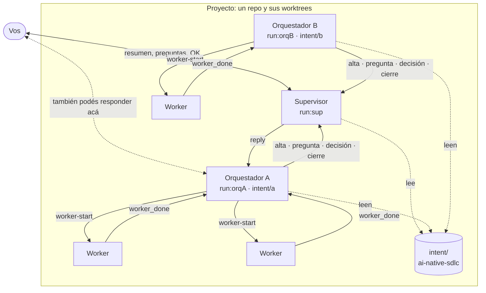
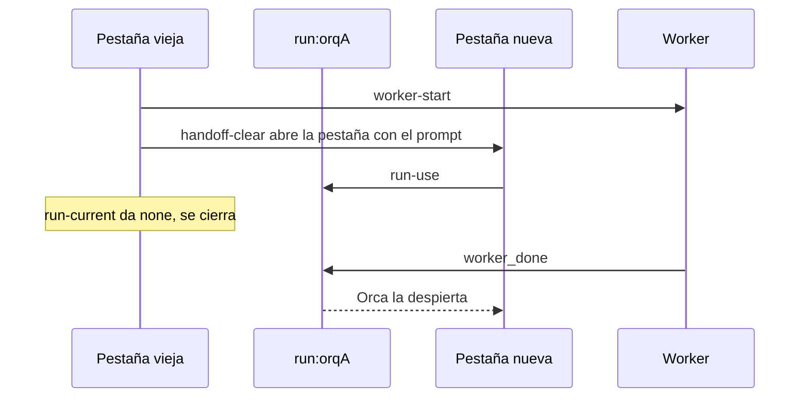

# supervisar

[English](README.md)

Skill de Claude Code para manejar desde una sola sesión, el **supervisor**, los orquestadores que
trabajan en paralelo en un mismo proyecto. Corre sobre [Orca](https://onorca.dev).

- [Para qué sirve](#para-qué-sirve)
- [Cómo funciona](#cómo-funciona)
- [Instalación](#instalación)
- [Uso](#uso)
- [Problemas comunes](#problemas-comunes)
- [Por qué funciona mejor en Orca](#por-qué-funciona-mejor-en-orca)
- [Llevarlo a Herdr](#llevarlo-a-herdr)

## Para qué sirve

Por cada idea es fácil terminar con cuatro o cinco chats de orquestador abiertos, cada uno con sus
tareas, sus preguntas y sus decisiones pendientes. El supervisor:

- da un resumen del estado: qué orquestador está vivo, qué preguntas siguen abiertas, qué está
  duplicado o bloqueado;
- junta las preguntas que necesitan una decisión tuya y le devuelve tu respuesta al orquestador;
- dice si una idea nueva corresponde a un intent existente o pide uno nuevo;
- propone acciones y pide tu OK: nunca lanza, cierra ni redirige nada por su cuenta.

Podés responder desde el supervisor o desde la pestaña del orquestador: en los dos casos la
decisión le llega al otro.

## Cómo funciona

Hay tres niveles. Los **workers** (Codex, Antigravity u otros agentes) implementan y revisan. Cada
**orquestador** lleva un intent y reparte el trabajo entre sus workers. El **supervisor** coordina
a los orquestadores de un proyecto, que es un repo con todos sus worktrees.



Cada flecha llena es un mensaje de Orca dirigido a un run (`run:<id>`). Las reglas que lo
mantienen liviano:

- **Cuatro mensajes, nada de avance.** Un orquestador le manda al supervisor solo `alta` al
  arrancar, `pregunta` cuando necesita tu decisión, `decisión` cuando respondiste en su pestaña y
  `cierre` al terminar. El supervisor lee el avance de Orca y de `intent/` cuando lo necesita, así
  su contexto se llena más despacio.
- **Un supervisor por proyecto.** Su dirección vive en `.git/supervisar/run`. Todos los worktrees
  del repo comparten ese `.git`, y git no lo versiona. Un orquestador que arranca en el repo lo
  encuentra solo; en un repo sin supervisor trabaja como siempre.
- **Un run por orquestador.** Sus workers y concilios van en ese run, y el traspaso se lleva el
  run entero.
- **Sin notas propias.** El supervisor reconstruye todo desde Orca y desde `intent/`.

Dos skills completan el esquema:

- [handoff-clear](https://github.com/Ranteck/handoff-clear) hace los traspasos. Abre la pestaña
  nueva con la línea "Supervisor: run `<id>`", cierra la vieja cuando la nueva tomó el run y mide
  el contexto. Supervisar propone el traspaso al 30 % (supervisor) o al 40 % (orquestador).
- [ai-native-sdlc](https://github.com/Ranteck/ai-native-sdlc) define `intent/`, el estado
  durable de cada proyecto. El supervisor lo lee para el resumen y para clasificar ideas nuevas.

## Instalación

Requisitos: Claude Code, Orca, [handoff-clear](https://github.com/Ranteck/handoff-clear)
instalado en `~/.claude/skills/handoff-clear` (supervisar usa su script `contexto`) y proyectos en
repos git. [ai-native-sdlc](https://github.com/Ranteck/ai-native-sdlc) es recomendado.

```bash
git clone https://github.com/Ranteck/supervisar.git ~/Proyectos/skills/supervisar
ln -s ~/Proyectos/skills/supervisar/skills/supervisar ~/.claude/skills/supervisar
```

Para comprobarlo, en una sesión nueva de Claude Code la lista de skills tiene que mostrar
`supervisar`.

## Uso

1. En una pestaña de Orca dentro del proyecto, abrí Claude Code y escribí:

   ```text
   Sos el supervisor; cargá `supervisar`.
   ```

   El supervisor crea su run, lo guarda en `.git/supervisar/run` y queda esperando mensajes.

2. Abrí los orquestadores como siempre, por ejemplo:

   ```text
   Sos el orquestador del intent intent/<slug>/intent.md.
   ```

   Cada uno carga la skill, encuentra al supervisor y le manda su `alta`.

3. Cuando un orquestador necesita una decisión, la pregunta aparece en el supervisor y en su
   pestaña. Respondé en cualquiera de los dos lados.

4. Pedile al supervisor "resumen" para ver el estado del proyecto.

## Problemas comunes

| Síntoma | Causa | Qué hacer |
| --- | --- | --- |
| Un orquestador no le manda el alta | Arrancó con el diálogo "Trust this folder?" de una carpeta nueva y no cargó la skill | Aceptá la carpeta antes de lanzarlo, o abrilo con "Supervisor: run `<id>`" en el prompt |
| El supervisor pregunta si reemplaza a otro | `.git/supervisar/terminal` nombra una pestaña que sigue abierta | Si es un supervisor viejo, aceptá; si no, cancelá y usá el que está abierto |
| El orquestador avisa que sigue sin supervisor | El run guardado ya no existe (`run_not_found`), por ejemplo tras resetear Orca | Abrí un supervisor nuevo: crea otro run y reescribe el archivo |

## Por qué funciona mejor en Orca

La orquestación de Orca (probado con 1.4.257) ya trae lo que el esquema necesita, sin un bus de
eventos propio:

- **Un run es una dirección estable, no una pestaña.** Cualquier sesión puede tomarlo con
  `orca orchestration run-use`, y los mensajes a `run:<id>` le llegan a quien lo coordine en ese
  momento.
- **Los mensajes despiertan a quien los recibe.** Orca avisa dentro de la sesión de Claude Code
  ("You have 1 orchestration message"), así que nadie hace polling: tu respuesta despierta al
  orquestador y una pregunta despierta al supervisor.
- **El inbox persiste.** Si el destinatario está ocupado o entre sesiones, los mensajes esperan.
  Las respuestas (`reply`) quedan en el run del orquestador y se pueden releer con
  `orca orchestration inbox`.
- **Los workers reportan al run, no a la pestaña.** `worker-start` lanza el worker y su
  `worker_done` vuelve al run del orquestador.
- **Cada mensaje trae la pestaña que lo mandó.** Con `orca terminal list` el supervisor sabe si un
  orquestador sigue vivo, y `orca worktree ps` y `orca search` completan el estado.

Lo que más se nota es el traspaso: la pestaña nueva toma el run y recibe lo que quedó pendiente,
aunque un worker siga corriendo.



## Llevarlo a Herdr

[Herdr](https://herdr.dev) también organiza agentes en pestañas y paneles. La tabla compara lo que
el esquema usa de Orca con lo que expone la CLI de Herdr 0.9.5 (`herdr --help`, `herdr agent`,
`herdr notification`). No lo probé en Herdr: es lo que habría que construir encima.

| El esquema necesita | En Orca | En Herdr hoy | Qué habría que agregar |
| --- | --- | --- | --- |
| Una dirección que sobreviva al traspaso | `run:<id>`, que se toma con `run-use` | Agentes por nombre o id de panel; el nombre se borra cuando el agente sale | Un registro del nombre de cada rol (por ejemplo en `.git/supervisar/`) y pasárselo a la pestaña nueva con `herdr agent rename` |
| Mensajes que esperan | Inbox por run | `agent prompt` escribe en el panel, y rechaza a un agente `blocked`; no hay cola | Un buzón por destinatario, por ejemplo archivos en `.git/supervisar/inbox/` |
| Despertar sin polling | Aviso dentro de la sesión | `agent prompt` despierta a un agente `idle` | Un proceso que entregue el buzón cuando el destinatario pase a `idle` (`herdr agent wait --until idle`) |
| Respuestas con hilo | `reply --id <msg>` | No hay | Un id por mensaje y el destinatario de la respuesta en el buzón |
| Workers que reportan al orquestador | `worker-start` y `worker_done` | `agent start` y `agent prompt --wait`, que bloquean al que espera | Que el worker escriba su resultado en el buzón del orquestador |
| Saber si un orquestador está vivo | Pestaña del remitente en `terminal list` | `agent list` y `agent get` dan `idle`, `working`, `blocked` o `done` | Nada: acá Herdr da más información que Orca |
| Ver si respondiste en una pestaña | `orca search` | `agent read` de cada panel | Leer los paneles o los transcripts de Claude Code |

`herdr notification show` muestra una notificación de escritorio para vos, no un mensaje para otro
agente.

## Licencia

MIT
