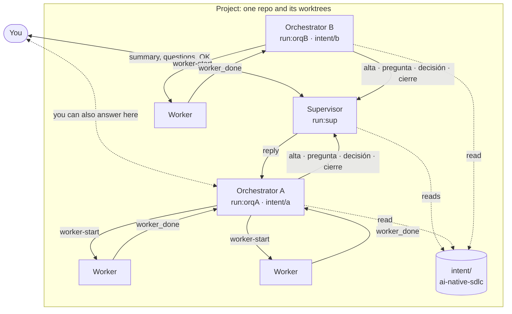
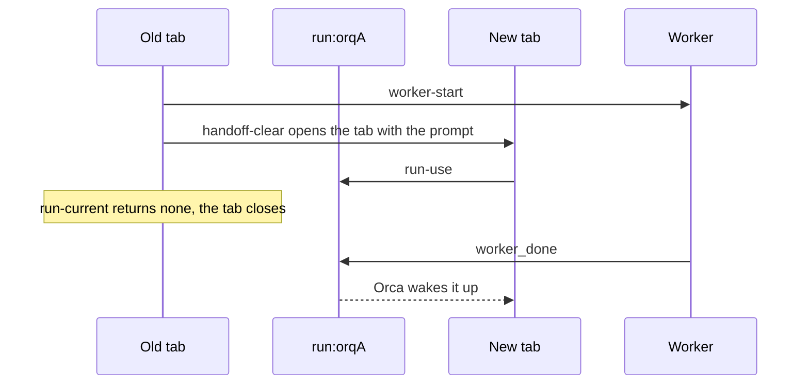

# supervisar

A Claude Code skill to manage, from a single session (the **supervisor**), the orchestrators
working in parallel on one project. It runs on [Orca](https://onorca.dev). The skill text and its
prompts are in Spanish.

- [What it does](#what-it-does)
- [How it works](#how-it-works)
- [Installation](#installation)
- [Usage](#usage)
- [Common problems](#common-problems)
- [Why it works better on Orca](#why-it-works-better-on-orca)
- [Porting it to Herdr](#porting-it-to-herdr)

## What it does

For every idea it is easy to end up with four or five orchestrator chats open, each with its own
tasks, questions and pending decisions. The supervisor:

- summarizes the state: which orchestrators are alive, which questions are still open, what is
  duplicated or blocked;
- collects the questions that need your decision and sends your answer back to the orchestrator;
- tells you whether a new idea belongs to an existing intent or needs a new one;
- proposes actions and asks for your OK: it never launches, closes or redirects anything on its
  own.

You can answer from the supervisor or from the orchestrator's tab: either way, the decision
reaches the other side.

## How it works

There are three levels. **Workers** (Codex, Antigravity or other agents) implement and review.
Each **orchestrator** owns an intent and splits the work among its workers. The **supervisor**
coordinates the orchestrators of one project, which is a repo with all its worktrees.



Arrows between agents are Orca messages or commands addressed to a run (`run:<id>`). The rules
that keep it light:

- **Four messages, no progress reports.** An orchestrator sends the supervisor only `alta`
  (sign-on) when it starts, `pregunta` (question) when it needs your decision, `decisión`
  (decision) when you answered in its tab, and `cierre` (close) when it finishes. The supervisor
  reads progress from Orca and `intent/` when it needs it, so its context fills up more slowly.
- **One supervisor per project.** Its address lives in `.git/supervisar/run`. Every worktree of
  the repo shares that `.git`, and git does not track it. An orchestrator that starts in the repo
  finds the supervisor on its own; in a repo without one, it works as usual.
- **One run per orchestrator.** Its workers and reviews run inside that run, and a handoff carries
  the whole run.
- **No private notes.** The supervisor rebuilds everything from Orca and `intent/`.

Two skills complete the scheme:

- [handoff-clear](https://github.com/Ranteck/handoff-clear) does the handoffs. It opens the new tab
  with the line "Supervisor: run `<id>`", closes the old one once the new one has taken the run,
  and measures context. Supervisar proposes a handoff at 30 % (supervisor) or 40 %
  (orchestrator).
- [ai-native-sdlc](https://github.com/Ranteck/ai-native-sdlc) defines `intent/`, the durable state
  of each project. The supervisor reads it for the summary and to classify new ideas.

## Installation

Requirements: Claude Code, Orca, [handoff-clear](https://github.com/Ranteck/handoff-clear)
installed at `~/.claude/skills/handoff-clear` (supervisar uses its `contexto` script), and
projects in git repos. [ai-native-sdlc](https://github.com/Ranteck/ai-native-sdlc) is
recommended.

```bash
git clone https://github.com/Ranteck/supervisar.git ~/Proyectos/skills/supervisar
ln -s ~/Proyectos/skills/supervisar/skills/supervisar ~/.claude/skills/supervisar
```

To check it, the skill list of a new Claude Code session must show `supervisar`.

## Usage

1. In an Orca tab inside the project, open Claude Code and type:

   ```text
   Sos el supervisor; cargá `supervisar`.
   ```

   The supervisor creates its run, saves it in `.git/supervisar/run` and waits for messages.

2. Open the orchestrators as usual, for example:

   ```text
   Sos el orquestador del intent intent/<slug>/intent.md.
   ```

   Each one loads the skill, finds the supervisor and sends its `alta`.

3. When an orchestrator needs a decision, the question shows up in the supervisor and in its tab.
   Answer on either side.

4. Ask the supervisor for "resumen" (summary) to see the state of the project.

## Common problems

| Symptom | Cause | What to do |
| --- | --- | --- |
| An orchestrator does not send its `alta` | It started with the "Trust this folder?" dialog of a new folder and did not load the skill | Trust the folder before launching it, or start it with "Supervisor: run `<id>`" in the prompt |
| The supervisor asks whether to replace another one | `.git/supervisar/terminal` names a tab that is still open | If it is an old supervisor, accept; otherwise cancel and use the open one |
| The orchestrator says it continues without a supervisor | The saved run no longer exists (`run_not_found`), for example after resetting Orca | Open a new supervisor: it creates another run and rewrites the file |

## Why it works better on Orca

Orca's orchestration (tested with 1.4.257) already provides what the scheme needs, without a
custom event bus:

- **A run is a stable address, not a tab.** Any session can take it with
  `orca orchestration run-use`, and messages to `run:<id>` reach whoever coordinates it at that
  moment.
- **Messages wake up their recipient.** Orca notifies inside the Claude Code session ("You have 1
  orchestration message"), so nobody polls: your answer wakes the orchestrator, and a question
  wakes the supervisor.
- **The inbox persists.** Messages reach the recipient's Claude Code session even mid-turn, and
  they stay in the run's inbox, so a new session that takes the run can reread them with
  `orca orchestration inbox`. Replies (`reply`) stay in the orchestrator's run.
- **Workers report to the run, not to the tab.** `worker-start` launches the worker and its
  `worker_done` goes back to the orchestrator's run.
- **Each message carries the tab that sent it.** With `orca terminal list` the supervisor knows
  whether an orchestrator's tab is still open. `orca worktree ps` (sessions in the worktrees Orca
  knows about) and `orca search` (full-text search over agent sessions) fill in the rest.

The handoff is where this shows most: the new tab takes the run and receives whatever was pending,
even while a worker is still running.



## Porting it to Herdr

[Herdr](https://herdr.dev) also organizes agents in tabs and panes. The table compares what the
scheme uses from Orca with what the Herdr 0.9.5 CLI exposes (`herdr --help`, `herdr agent`,
`herdr notification`). It was not tested on Herdr: it lists what would have to be built on top.

| The scheme needs | On Orca | On Herdr today | What would have to be added |
| --- | --- | --- | --- |
| An address that survives a handoff | `run:<id>`, taken with `run-use` | Agents by name or pane id; the name is cleared when the agent exits | A registry of each role's name (for example in `.git/supervisar/`), handed to the new tab with `herdr agent rename` |
| Messages that wait | One inbox per run | `agent prompt` types into the pane and rejects a `blocked` agent; there is no queue | One mailbox per recipient, for example files in `.git/supervisar/inbox/` |
| Wake-up without polling | Notice inside the session | `agent prompt` wakes an `idle` agent | A process that delivers the mailbox when the recipient turns `idle` (`herdr agent wait --until idle`) |
| Threaded replies | `reply --id <msg>` | None | A message id and a reply-to recipient in the mailbox |
| Workers reporting to the orchestrator | `worker-start` and `worker_done` | `agent start` and `agent prompt --wait`, which block the caller | Workers write their result to the orchestrator's mailbox |
| Knowing whether an orchestrator is alive | Sender tab in `terminal list` | `agent list` and `agent get` report `idle`, `working`, `blocked` or `done` | Nothing: here Herdr gives more information than Orca |
| Seeing whether you answered in a tab | `orca search` | `agent read` on each pane | Read the panes or the Claude Code transcripts |

`herdr notification show` displays a desktop notification for you, not a message for another
agent.

## License

MIT
